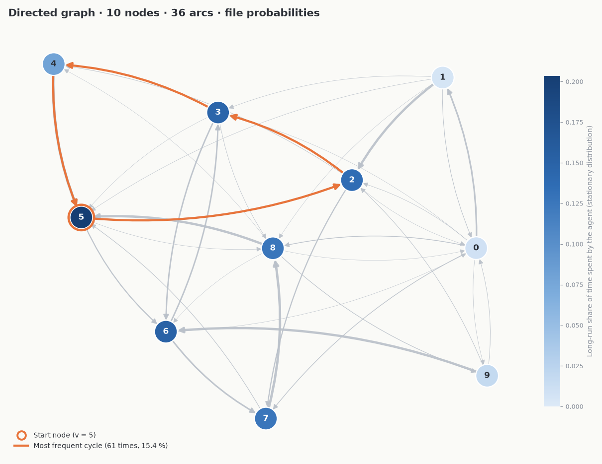

# ThGrapheProject

Random walks and closed-walk statistics on directed graphs.

Given a strongly connected directed graph, a path length `N` and a node `v`, the program:

1. computes the number of closed walks of length exactly `N` on `v` (entry `A^N[v][v]` of the adjacency matrix),
2. estimates the probability of coming back to `v` with a walk of length exactly `N`, and of length at most `N`,
3. sends an agent on random walks from `v` (100 runs, each run collects distinct cycles back to `v` until one repeats),
4. prints statistics on those cycles (shortest, longest, total count, mean length, variance) and writes the full frequency table to `stats.txt`.

## Requirements

Python 3.9+ and:

```bash
pip install -r requirements.txt   # numpy, networkx, scipy, matplotlib
```

## Usage

```bash
python3 main.py -f FILE.json [-p] [-d] [--show]
```

| Option | Description |
|---|---|
| `-f`, `--file` | JSON graph file to read (required) |
| `-p` | Use the edge probabilities from the file for the random walk instead of a uniform choice among successors |
| `-d`, `--debug` | Debug mode: prints the graph, the adjacency matrix and its powers |
| `--show` | Display the graph in a window (see below) |
| `-h` | Help |

The program then asks for the path length `N` (> 0) and the start node `v` (between 0 and number of nodes − 1).

Example:

```bash
$ printf '10\n5\n' | python3 main.py -f samples/graph-10-nodes.json
...
Probability of returning to v with a walk of length exactly N: 0.010865441600677761
Probability of returning to v with a walk of length at most N: 0.0704339965204932
...
```

The two probabilities are deterministic; the random-walk statistics change on every run.

## Graph view (`--show`)

After the statistics, `--show` opens a matplotlib window:



*`python3 main.py -f samples/graph-10-nodes.json -p --show` with `N = 10`, `v = 5`.*

It shows:

- nodes coloured by the long-run share of time the agent spends on them (stationary distribution of the random walk, uniform or `-p`),
- the start node `v` circled, and the most frequent cycle found by the agent highlighted,
- curved arcs so that `u → v` and `v → u` stay distinct; with `-p`, arc width follows its probability (and probabilities are written on the arcs for small graphs).

## Graph file format

```json
{
  "nodeCount": 3,
  "nodes": [
    { "id": 0, "arcs": [1],    "p": [1] },
    { "id": 1, "arcs": [0, 2], "p": [0.25, 0.75] },
    { "id": 2, "arcs": [0],    "p": [1] }
  ]
}
```

- `nodeCount`: number of nodes, numbered `0` to `nodeCount - 1`
- `arcs`: successors of the node
- `p`: probability of each arc (same order as `arcs`, summing to 1), used with `-p`

## Generating a random graph

```bash
python3 generator.py
```

Asks for the number of nodes and writes a random graph with random arc probabilities to `graph.json`. Every node `i` links to `i + 1` (the last one to `0`), so the generated graph is always strongly connected.

## Sample files (`samples/`)

| File | Result |
|---|---|
| `single-node.json` | Rejected: single node, nothing to walk |
| `not-strongly-connected.json` | Rejected: graph is not strongly connected |
| `graph-5-nodes.json` | Small 5-node graph |
| `graph-10-nodes.json` | With `N = 10`, `v = 5`: exactly-N probability `0.010865441600677761`, at-most-N probability `0.0704339965204932` |
| `graph-100-nodes.json` | 100-node graph. With `-p` its probabilities are heavily skewed, so cycles get very long and the run takes a few minutes |

With `-p`, the total count of cycles is usually smaller than with the uniform choice on small graphs.

## Project layout

| File | Role |
|---|---|
| `main.py` | Command-line entry point |
| `file.py` | Graph loading, matrix computations, random walks, statistics |
| `view.py` | Graph rendering for `--show` |
| `utils.py` | Global flags, random graph helpers, `stats.txt` writer |
| `generator.py` | Random graph generator |
